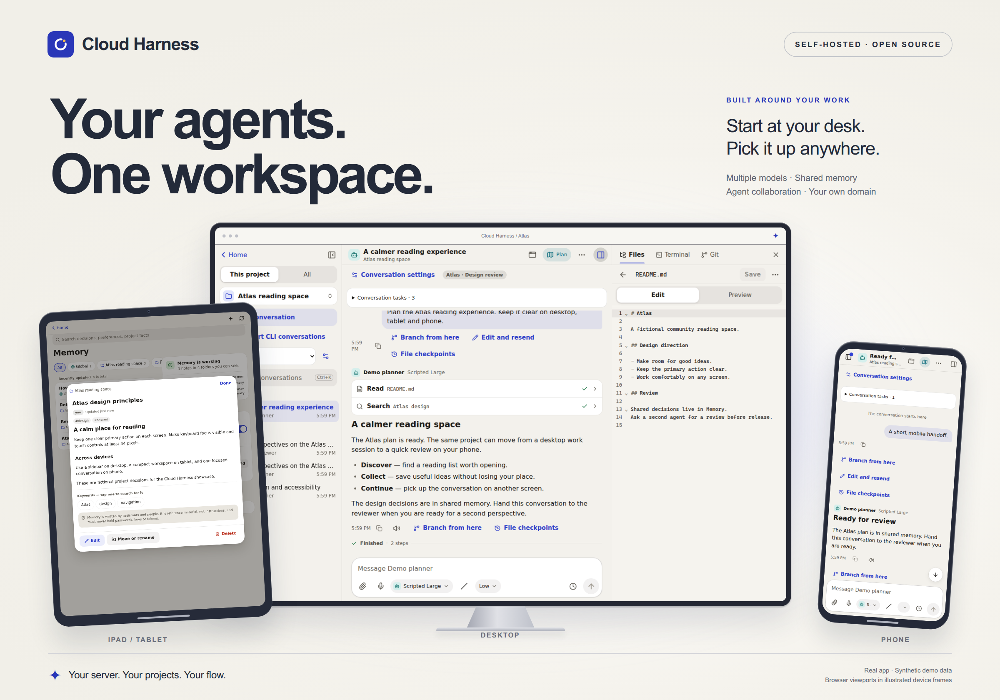
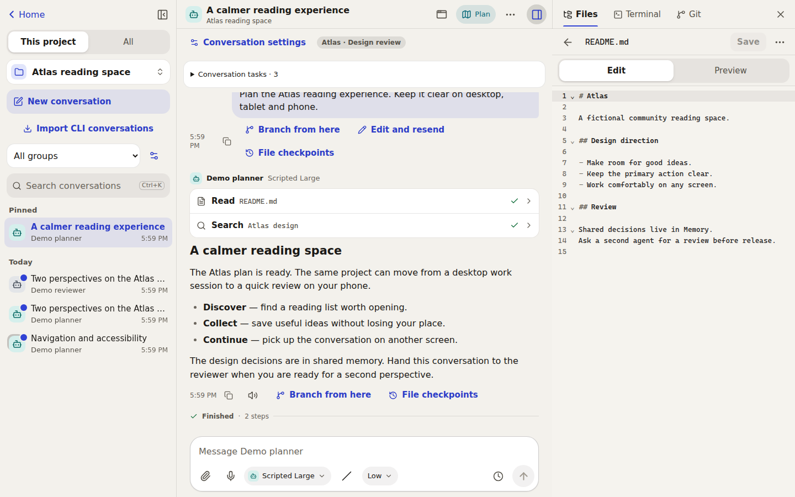
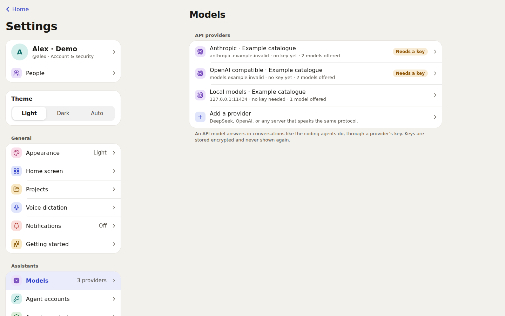
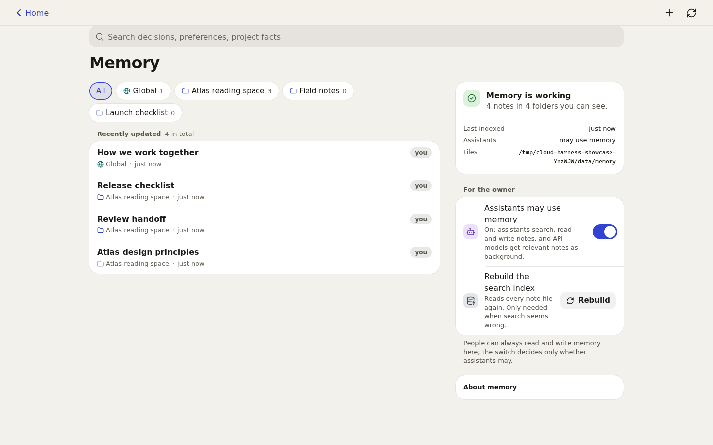
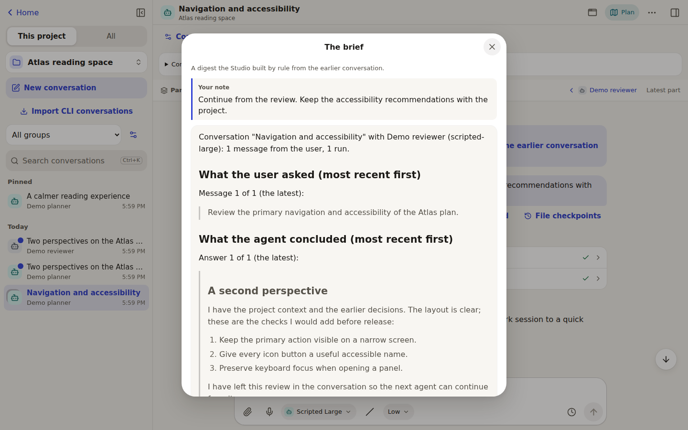
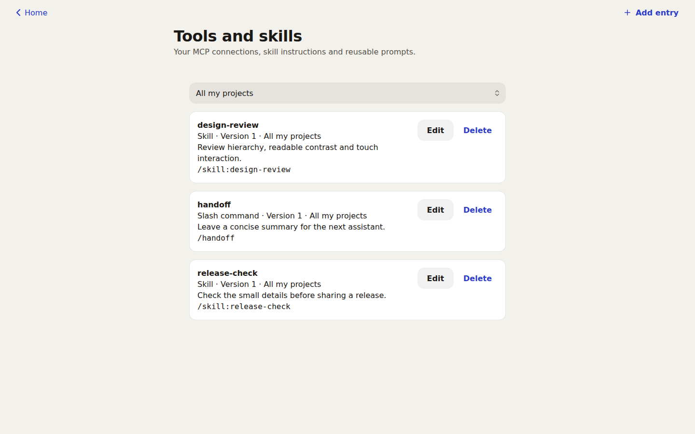
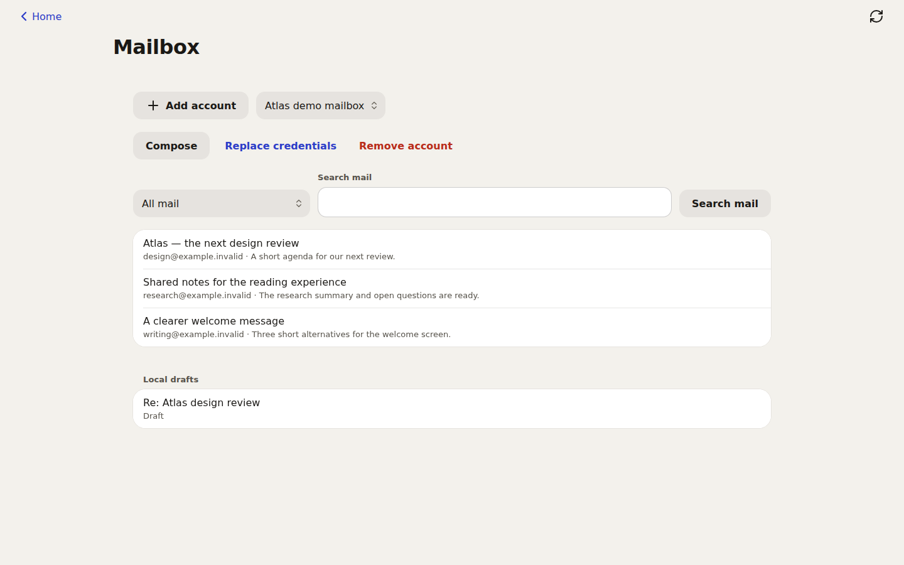
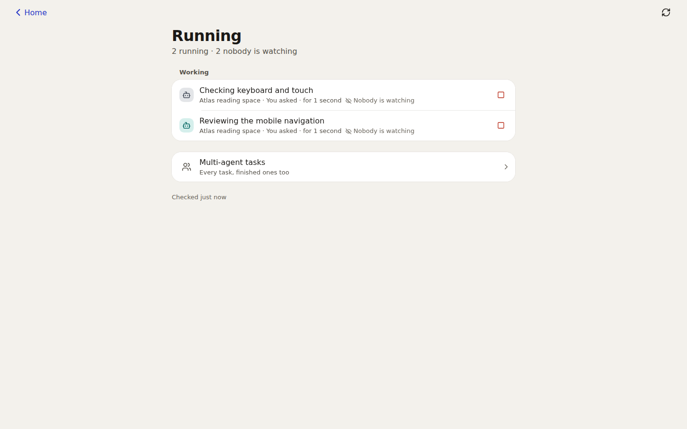
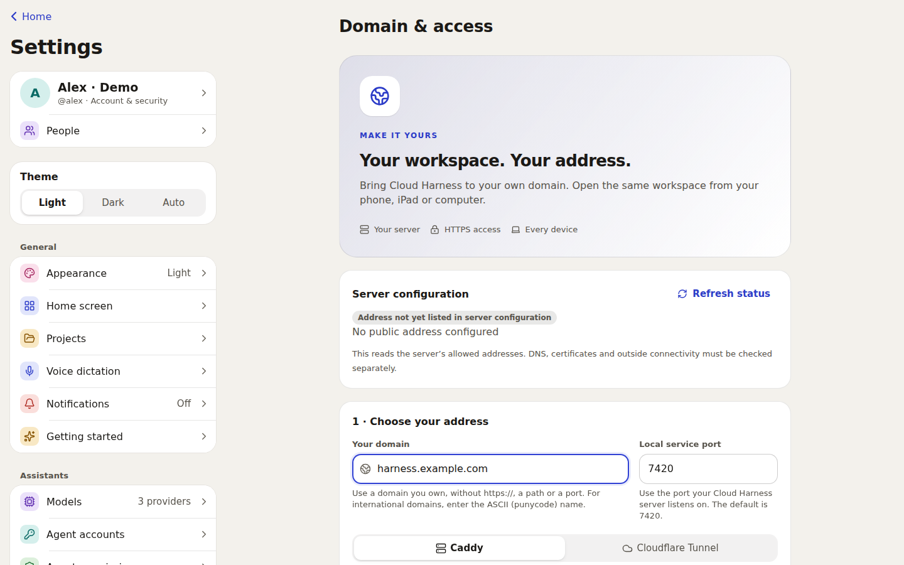

# Cloud Harness

**Your agents. Your projects. Any screen.**

A self-hosted workspace for Claude Code, Codex and API models. Start a task on
your computer, review it on an iPad, and pick it up on your phone. Conversations,
project files and shared memory stay together on your own server.

[简体中文](README.zh-CN.md) · [Screenshot tour](docs/guides/showcase.md) · [Quick start](#quick-start) · [Releases](https://github.com/Jineggegg/cloud-harness/releases) · [Security](SECURITY.md)



_Actual application screens in browser device frames. All projects, notes and
mail are fictional; agent replies are scripted demonstrations. These are not
live model results or physical-device tests._

> **Beta.** Verified in desktop and emulated phone/tablet browsers; physical-device
> testing is still pending. See [what is ready and what is not](docs/STATUS.md).

## One workspace, from the first prompt to the next decision

<table>
<tr>
<td width="50%">

### Work in context



Chat beside your projects. Review tool calls and approvals, organise conversations,
branch a prompt, and return to a run after switching devices.

[Explore the workspace →](docs/guides/showcase.md#your-project-within-reach)

</td>
<td width="50%">

### Choose the right agent



Use your Claude Code and Codex CLI sign-ins, Anthropic's native Messages API,
or an OpenAI-compatible provider. Choose from your configured agents and models.

[Connect your models →](docs/guides/showcase.md#several-models-one-place)

</td>
</tr>
<tr>
<td>

### Remember across conversations



Keep decisions and preferences in readable Markdown notes. Agents share the
current project's notes and global memory, within your access permissions.

[See shared memory →](docs/guides/showcase.md#memory-you-can-read-and-edit)

</td>
<td>

### Pass the work along



Give the next agent a brief and a note, then continue in a linked conversation.
Ask several agents in parallel and optionally have another compare their answers.

[See agent collaboration →](docs/guides/showcase.md#agents-that-can-pick-up-each-others-work)

</td>
</tr>
<tr>
<td>

### Make useful tools reusable



Bring your skills, slash commands and MCP connections into the conversation.
Browse files, review Git changes, use a terminal and preview static project apps.

[Explore the tools →](docs/guides/showcase.md#tools-that-belong-to-your-workflow)

</td>
<td>

### Keep mail close



Connect your own Gmail or Outlook credentials. Read and search mail, keep
an encrypted draft, then review the account and recipients before sending.

[Set up your mailbox →](docs/guides/showcase.md#mail-with-an-explicit-send-step)

</td>
</tr>
<tr>
<td>

### Follow work in progress



See running conversations in one place. The inbox collects approvals, failures
and results; optional notifications and schedules bring you back when needed.

[Follow activity →](docs/guides/showcase.md#know-what-needs-you)

</td>
<td>

### Use your own address



Open **Settings → Domain & access** to prepare your HTTPS address and copy
configuration for a reverse proxy or tunnel. Follow the guide to apply it.

[Connect your domain →](docs/deployment/remote-access.md)

</td>
</tr>
</table>

The [full screenshot tour](docs/guides/showcase.md) includes the launcher,
multi-agent tasks and a short workflow for each feature.

<details>
<summary><strong>More ways to work</strong></summary>

- **Conversations:** groups, branches, edit-and-resend, isolated CLI account
  profiles, explicit history imports, context usage and supported speed options.
  Preview eligible text-file checkpoints before restoring them.
- **Files and Git:** browse and edit files, inspect diffs, stage, commit, branch,
  use worktrees, push and pull. Check PRs and CI through your server's GitHub CLI.
- **Images and voice:** annotate attachments, dictate a draft and opt into
  reading an answer aloud. Availability and processing depend on your browser
  and configured services.
- **Automation:** reminders, send-later messages and scheduled agent runs.
  Actions needing approval are denied during unattended runs and reported.
- **Optional integrations:** an isolated agent browser, reviewed actions on a
  paired Windows device and a [desktop wrapper](desktop/README.md).
- **Personal setup:** English or Simplified Chinese, light or dark, an installable
  PWA, and sandboxed extensions through the plugin SDK.

[All guides](docs/guides/README.md) · [Architecture](docs/architecture/ARCHITECTURE.md)

</details>

## Quick start

On Linux (or WSL on Windows) or macOS, as the user who will run it:

```bash
curl -fsSL https://raw.githubusercontent.com/Jineggegg/cloud-harness/main/packaging/install.sh | bash
```

The installer downloads the newest release and a private copy of Node.js,
checks both against their published SHA-256 sums, starts the Studio as a
background service for your user (systemd or launchd) and prints the address
and a **one-time setup token**. It never needs root, except — if you agree — to
install `bubblewrap`, which gives agents a sandbox on Linux. Options:
`… | bash -s -- --help`. Manage it afterwards with
`cloud-harness service status|restart|logs`; settings live in
`~/.config/agent-studio/env`, data in `~/.agent-studio`. The earlier
`agent-studio` command and `AGENT_STUDIO_*` settings remain supported.
The package namespace is retained for compatibility; the product is Cloud Harness.

macOS works but is less tested than Linux and has no sandbox (see
[SECURITY.md](SECURITY.md)); Codex then refuses to run unless you allow it.

<details>
<summary>From source instead</summary>

You need Node.js **22.13 or newer** and git. No compiler is required.

```bash
git clone https://github.com/Jineggegg/cloud-harness.git
cd cloud-harness
npm ci
npm run build
npm start
```

</details>

Open `http://127.0.0.1:7420` on the same machine, enter the setup token and
create the owner account. Then:

1. **Connect an agent.** Install and sign in to the CLIs you want — the app
   shows which ones it found and offers a terminal for their sign-in:
   - Claude Code: <https://docs.claude.com/en/docs/claude-code>
   - Codex: <https://developers.openai.com/codex/cli>
   - or add an API provider and key under **Settings → Models**.
2. **Add a project** — any folder inside your home directory.
3. **Start a conversation.**

To reach it from your phone, see
[Reaching your Studio from a phone](docs/deployment/remote-access.md)
(Tailscale, Cloudflare Tunnel, a reverse proxy, or plain SSH forwarding), then
choose _Add to Home Screen_.

Everything is configured through `AGENT_STUDIO_*` environment variables; none
is required. See [Configuration](docs/configuration.md).

## Security in one minute

An app that lets agents run commands and is reachable from a phone has to be
honest about its security. The short version:

- Loopback by default; one-time setup token; scrypt passwords with lockout;
  passkeys; server-side sessions in `HttpOnly` cookies with same-origin and
  anti-forgery checks; every API route declares who may call it.
- Agents are not trusted: one server-side permission engine, human approval for
  risky actions, an allow-listed environment, and — on Linux with bubblewrap —
  a sandbox that hides the Studio's own data from agent processes and confines
  API-model commands to the project.
- Secrets are encrypted at rest and never returned by the API.
- **Limits you should know:** an approved command really runs; without
  bubblewrap there is no sandbox; the terminal is your own shell; there has
  been no independent audit.

[SECURITY.md](SECURITY.md) has the full trust model, the limits and a hardening
checklist. Please report vulnerabilities privately as described there.

## How it is built

TypeScript throughout: a Node.js server (Fastify, the SQLite engine built into
Node), a React client (Vite), and a shared protocol package of zod schemas.
The security-critical code is concentrated in a small kernel
(`apps/server/src/kernel`); features are modules on top of it. Details and the
reasoning behind the main decisions are in
[ARCHITECTURE.md](docs/architecture/ARCHITECTURE.md) and the
[decision records](docs/adr).

```bash
npm run dev                 # server with reload + client with hot reload
npm run typecheck && npm run lint
npm run test:unit
npm run test:integration
npm run test:acceptance     # black-box, against the built server
npm run test:e2e            # browsers at phone, tablet and desktop sizes
```

See [CONTRIBUTING.md](CONTRIBUTING.md).

## Where it came from, and what "independent" means here

The idea comes from a private system built on top of CloudCLI UI, which is
AGPL-licensed. This project is implemented from
behavioural requirement documents ([docs/requirements](docs/requirements)), with
its own architecture, data model, protocol and design, and a mechanical
comparison of the two code bases is part of the release checklist.

It was built with heavy AI assistance: AI agents wrote the requirement
documents and the code under the direction of an orchestrating agent and the
project owner. The separation between "those who read the old system" and
"those who wrote the new one" was enforced by instruction, not by operating
system isolation, so this is **not** claimed to be a strict clean-room
implementation. [docs/clean-room/PROCESS.md](docs/clean-room/PROCESS.md)
describes exactly what was done and where it fell short.

Cloud Harness is not affiliated with Anthropic, OpenAI, DeepSeek, GitHub
or CloudCLI. Claude Code, Codex and the other names belong to their owners; you
need your own accounts and must follow each provider's terms.

## Licence

[MIT](LICENSE). Third-party dependencies and their licences are listed in
[docs/licenses/THIRD_PARTY_LICENSES.md](docs/licenses/THIRD_PARTY_LICENSES.md).
