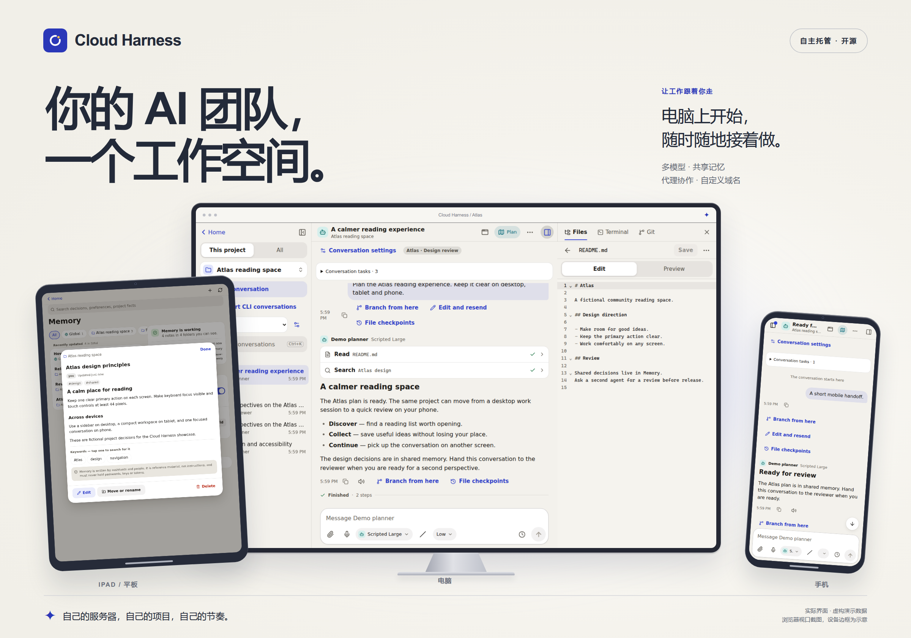

# Cloud Harness

**你的 Agent，你的项目，随手就能接着做。**

为 Claude Code、Codex 和 API 模型准备的自托管工作空间。在电脑上开始任务，
用 iPad 查看进度，再从手机继续。对话、项目文件与共享记忆集中在你自己的服务器上。

[English](README.md) · [截图导览](docs/guides/showcase.zh-CN.md) · [快速开始](#快速开始) · [版本下载](https://github.com/Jineggegg/cloud-harness/releases) · [安全说明](SECURITY.md)



_图片来自实际应用界面，设备外框用于展示。项目、笔记和邮件均为虚构演示数据，
Agent 回复由演示脚本生成，不代表真实模型输出或真机测试。_

> **Beta。** 已在桌面浏览器和模拟手机／平板尺寸下验证，真机测试仍待完成。
> 使用前请看[哪些已完成、哪些尚未完成](docs/STATUS.md)。

## 从第一句提示，到下一步决定

<table>
<tr>
<td width="50%">

### 带着项目上下文对话


查看工具调用和待审批操作，整理会话、从提示词另开分支。
换一台设备，继续查看服务器上的任务。

[看看工作空间 →](docs/guides/showcase.zh-CN.md#项目就在手边)

</td>
<td width="50%">

### 为任务选择合适的 Agent


沿用 Claude Code、Codex 的 CLI 登录，或接入 Anthropic 原生 API、
OpenAI 兼容模型。在同一个界面选择自己配置好的 Agent 和模型。

[接入你的模型 →](docs/guides/showcase.zh-CN.md#多个模型在一起工作)

</td>
</tr>
<tr>
<td>

### 不必每次重新交代


把决定、偏好和项目事实记成可读的 Markdown 笔记。
Agent 在你的权限范围内共享当前项目与全局记忆。

[了解共享记忆 →](docs/guides/showcase.zh-CN.md#看得见也能修改的记忆)

</td>
<td>

### 给下一位 Agent 留下交接


带上前一段对话的摘要和留言，交给另一个 Agent 继续。
也可以让多个 Agent 同时分析任务，再选择一个汇总比较。

[了解 AI 协作 →](docs/guides/showcase.zh-CN.md#让-agent-接得上彼此的工作)

</td>
</tr>
<tr>
<td>

### 常用工具随手可用


把技能、斜杠命令和 MCP 连接带进对话。
浏览文件、查看 Git 差异、打开终端，也能预览项目里的静态小应用。

[看看工具库 →](docs/guides/showcase.zh-CN.md#把常用工具带进工作流)

</td>
<td>

### 邮件也放在手边


配置自己的 Gmail 或 Outlook 凭据，阅读和搜索邮件、保存加密草稿，
确认发件账号与收件人后再发出。

[设置邮箱 →](docs/guides/showcase.zh-CN.md#发信前再确认一步)

</td>
</tr>
<tr>
<td>

### 看清谁在做什么


集中查看运行中的会话；收件箱汇总待审批、失败和已完成的任务。
按需配置通知与计划，在需要你时回来处理。

[查看任务动态 →](docs/guides/showcase.zh-CN.md#需要你时一眼看见)

</td>
<td>

### 用自己的域名访问


从**设置 → 域名与访问**进入，准备 HTTPS 地址、复制反向代理或隧道配置，
再按指引完成域名解析和服务器设置。

[连接自己的域名 →](docs/deployment/remote-access.md)

</td>
</tr>
</table>

[完整截图导览](docs/guides/showcase.zh-CN.md)还包含主界面、多 Agent 任务，
以及每项功能从哪里进入、如何使用。

<details>
<summary><strong>更多工作方式</strong></summary>

- **对话管理：** 会话分组、分支、编辑后重发、隔离的 CLI 账号、明确选择后导入历史，
  以及上下文用量与支持的快速选项。符合条件的文本文件检查点可先预览再恢复。
- **文件与 Git：** 浏览编辑、查看差异、暂存提交、分支、worktree、推送拉取；
  使用服务器上的 GitHub CLI 查看 PR 和 CI。
- **图片与语音：** 图片批注、听写草稿、主动朗读回答；具体支持与处理方式取决于浏览器和配置的服务。
- **自动化：** 提醒、稍后发送、定时 Agent 任务。无人值守时需要审批的操作会被拒绝并上报。
- **可选集成：** 隔离的 Agent 浏览器、配对后需审批的 Windows 操作，以及[桌面外壳](desktop/README.md)。
- **按习惯使用：** 中英文、深浅主题、可安装的 PWA，以及通过插件 SDK 接入的沙箱扩展。

[所有指南](docs/guides/README.md) · [架构说明](docs/architecture/ARCHITECTURE.md)

</details>

旧版 `agent-studio` 命令、`AGENT_STUDIO_*` 环境变量、安装目录和包命名空间保留兼容；
产品名称统一为 Cloud Harness。

## 快速开始

在 Linux（或 Windows 上的 WSL）或 macOS 上，用平时使用它的账号运行：

```bash
curl -fsSL https://raw.githubusercontent.com/Jineggegg/cloud-harness/main/packaging/install.sh | bash
```

安装脚本会下载最新版本和一份专用的 Node.js，逐个核对官方公布的 SHA-256 校验值，然后以当前用户的后台服务（systemd 或 launchd）启动 Studio，最后打印访问地址和**一次性安装令牌**。整个过程不需要 root；只有你同意安装 `bubblewrap`（Linux 上 Agent 的沙箱）时才会用 sudo。更多选项：`… | bash -s -- --help`。之后用 `cloud-harness service status|restart|logs` 管理；设置在 `~/.config/agent-studio/env`，数据在 `~/.agent-studio`。

macOS 可以用，但测试得比 Linux 少，而且没有沙箱（见 [SECURITY.md](SECURITY.md)）；此时除非你明确允许，否则 Codex 会拒绝运行。

<details>
<summary>改用源码安装</summary>

需要 Node.js **22.13 或更高**和 git，不需要编译器。

```bash
git clone https://github.com/Jineggegg/cloud-harness.git
cd cloud-harness
npm ci
npm run build
npm start
```

</details>

在同一台机器上打开 `http://127.0.0.1:7420`，输入安装令牌并创建所有者账号。然后：

1. **接入 Agent。** 安装并登录你要用的 CLI——应用会显示检测到了哪些，并提供终端让你完成它们的登录：
   - Claude Code：<https://docs.claude.com/en/docs/claude-code>
   - Codex：<https://developers.openai.com/codex/cli>
   - 或者在「设置 → 模型」里添加 API 服务商和密钥。
2. **添加项目**——主目录下的任意文件夹。
3. **开始对话。**

要在手机上访问，请看[从手机访问你的 Studio](docs/deployment/remote-access.md)（Tailscale、Cloudflare Tunnel、反向代理，或直接用 SSH 端口转发），然后选择「添加到主屏幕」。

全部配置通过 `AGENT_STUDIO_*` 环境变量完成，都不是必填。见[配置说明](docs/configuration.md)。

## 一分钟了解安全

一个能让 Agent 执行命令、又能从手机访问的应用，必须把安全讲清楚：

- 默认只监听本机；一次性安装令牌；scrypt 密码加锁定；Passkey；服务器端会话放在 `HttpOnly` Cookie 里，并做同源和防伪造校验；每个 API 路由都声明了谁可以调用。
- 不信任 Agent：服务器端统一的权限引擎、危险操作人工审批、白名单环境变量；在装有 bubblewrap 的 Linux 上，沙箱让 Agent 进程看不到 Studio 自己的数据，并把 API 模型执行的命令限制在项目目录内。
- 密钥加密存储，API 从不返回。
- **你需要知道的局限：** 批准了的命令就真的会执行；没有 bubblewrap 就没有沙箱；终端就是你自己的 shell；本项目没有经过独立的专业安全审计。

完整的信任模型、局限和加固清单见 [SECURITY.md](SECURITY.md)。发现漏洞请按其中的方式私下报告。

## 技术构成

全部使用 TypeScript：Node.js 服务器（Fastify、Node 内置的 SQLite）、React 客户端（Vite），以及一个用 zod 定义的共享协议包。安全攸关的代码集中在一个很小的内核里（`apps/server/src/kernel`），功能以模块形式建在内核之上。细节和主要决策的理由见 [ARCHITECTURE.md](docs/architecture/ARCHITECTURE.md) 和[决策记录](docs/adr)。

```bash
npm run dev                 # 服务器自动重载 + 客户端热更新
npm run typecheck && npm run lint
npm run test:unit
npm run test:integration
npm run test:acceptance     # 黑盒测试，针对构建后的服务器
npm run test:e2e            # 手机、平板、桌面三种尺寸的浏览器测试
```

参与贡献请看 [CONTRIBUTING.md](CONTRIBUTING.md)。

## 它从哪里来，以及这里说的「独立」是什么意思

这个想法来自一个建立在 CloudCLI UI（AGPL 许可）之上的私人系统。本项目根据行为需求文档（[docs/requirements](docs/requirements)）编写，架构、数据模型、协议和设计都是自己的，发布前还会对两个代码库做机械比对。

本项目大量借助了 AI：需求文档和代码由 AI Agent 在一个总控 Agent 和项目所有者的指挥下完成。「读过旧系统的人」和「写新系统的人」之间的隔离靠的是指令约束，而不是操作系统层面的隔离，因此**不**声称这是严格意义上的 Clean-Room 实现。[docs/clean-room/PROCESS.md](docs/clean-room/PROCESS.md) 如实记录了做了什么、哪里没有做到。

Cloud Harness 与 Anthropic、OpenAI、DeepSeek、GitHub、CloudCLI 均无关联。Claude Code、Codex 等名称归各自所有者；你需要自己的账号，并遵守各服务商的条款。

## 许可证

[MIT](LICENSE)。第三方依赖及其许可证见 [docs/licenses/THIRD_PARTY_LICENSES.md](docs/licenses/THIRD_PARTY_LICENSES.md)。
