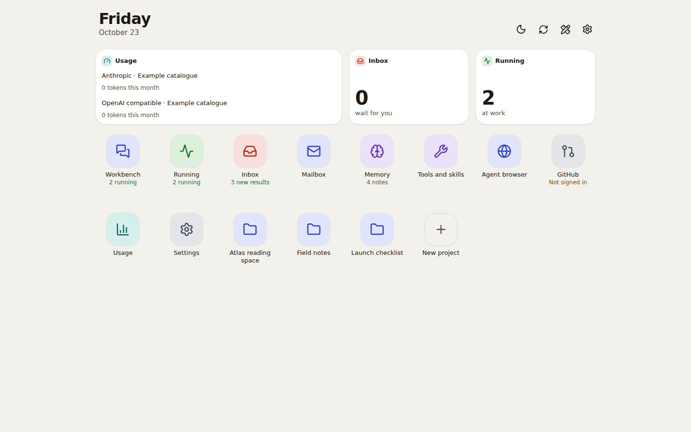
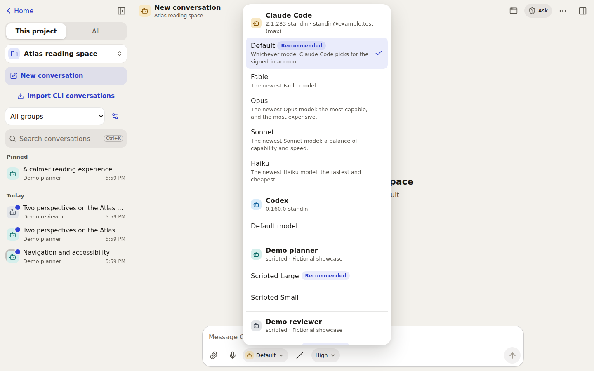
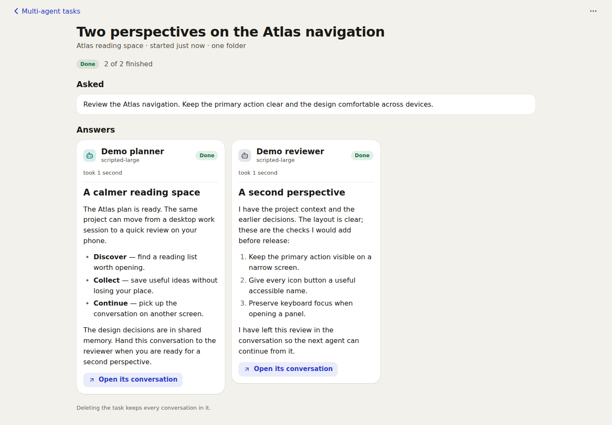
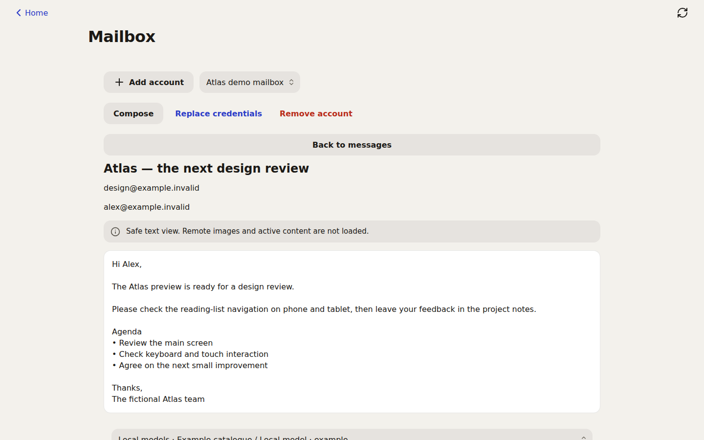
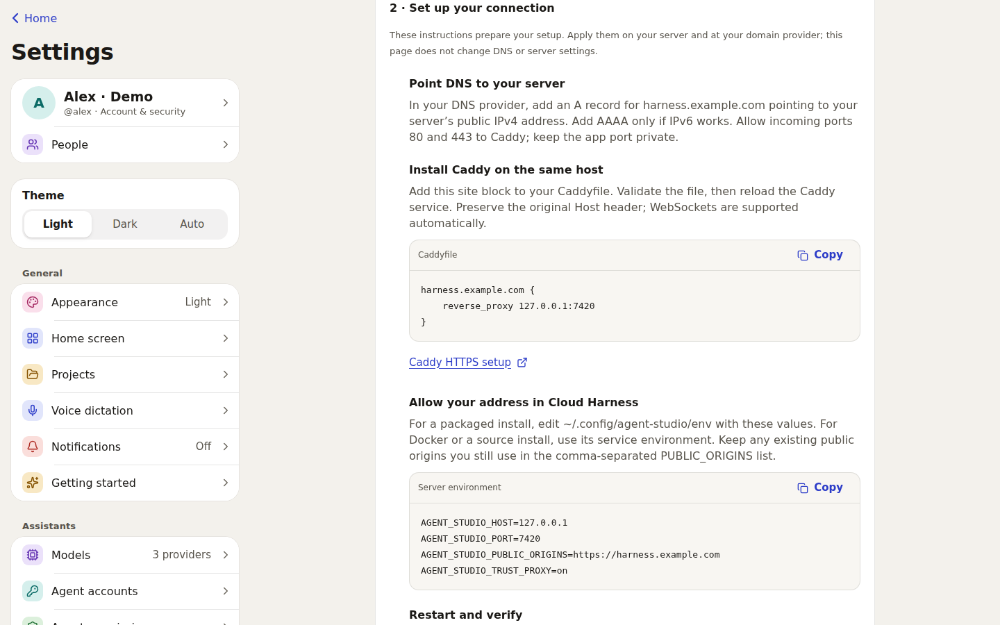
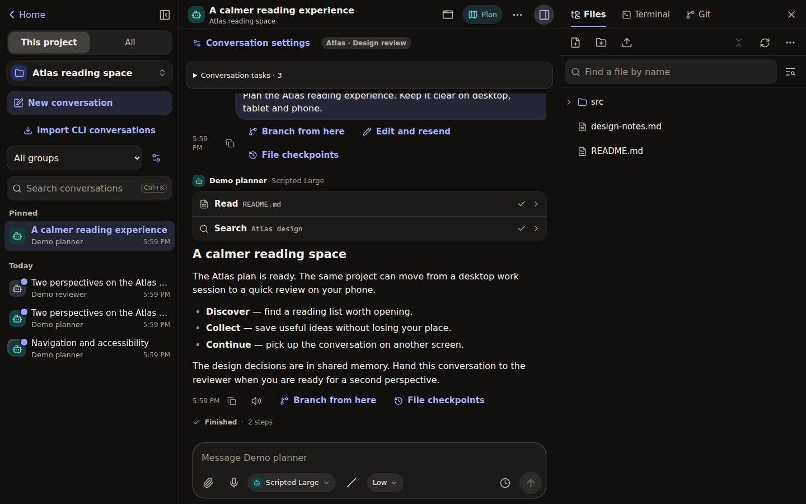

# A look around Cloud Harness

**One workspace for your agents, projects and everyday tools.**

[简体中文](showcase.zh-CN.md) · [Install Cloud Harness](../../README.md#quick-start) · [All guides](README.md)

These are screenshots of the running application with fictional projects,
notes and mail. Replies come from scripted demonstration agents, not live
Claude, Codex or API calls. Device frames show browser layouts, not physical
device tests. A fresh installation has no sample accounts, credentials or
integrations configured.

## Your project, within reach

The launcher brings projects, Memory, Inbox and your tools into one place.
Open a project to start a conversation or return to recent work. The layout
adapts to a phone, a tablet or a wide desktop window.

**Try it:** add a project, select an agent, then ask it to explain a file or plan
a change. Follow the reply, inspect a tool call and answer any approval in the
conversation. Open Files, Git or Terminal when you need the underlying work.
Runs live on the server, so a disconnected browser can reconnect to their
record. The server and agent process still need to remain running.

Groups keep related conversations together. **Fork here** and **Edit and
resend** explore another direction in a new conversation; they do not rewind
your project files. Eligible text-file checkpoints have a separate preview and
restore flow.

[Working on projects](working-on-projects.md) · [Conversations and branches](conversations.md)

## Several models, one place

Use Claude Code and Codex through their official CLIs, or add a provider using
Anthropic's native Messages API or an OpenAI-compatible API. Available models
come from your configuration and provider capabilities. Your sign-ins and
provider accounts remain your own.

**Try it:** sign in to a detected CLI, or open **Settings → Models** and add
your provider. Start a conversation and choose its agent and model. Isolated
CLI account profiles are available under **Settings → Agent accounts**.
To continue an existing conversation with a different agent, use a handoff.

[Model setup](providers.md) · [Agent permissions](agents-and-approvals.md)

## Memory you can read and edit

Keep a project decision once, then let the next conversation find it. Memory
uses Markdown notes that people can inspect and edit. Claude Code, Codex and
tool-capable API models use the same memory tools.

**Try it:** open **Memory**, create a note in your project's folder and write a
lasting decision, such as a preferred test command. In the next conversation,
ask the agent to find that decision before planning its work.

Each run can access its current project and **global**, subject to the user's
permissions. It cannot browse other projects' memory. Agents may read other
authors' notes but can modify only notes they created; writes also follow the
selected permission mode. The owner can disable agent access to memory.

[Memory scopes, permissions and editing](memory-automation-notifications.md#shared-memory)

## Agents that can pick up each other's work

Let one agent investigate, then give another its findings and your next step.
A handoff creates a linked conversation in the same project, carries a brief
of the earlier work and lets you add **A note for the new agent**. Both sides
keep a visible handoff record.

**Try it:** after a reply finishes, choose **Conversation actions (⋯) →
Continue with another agent…**. Select the recipient and brief format, add a
note such as “Review this plan for accessibility,” then choose **I will write
first** or **Start now**. You initiate the handoff; the app does not create an
autonomous back-and-forth chat between agents.

For parallel perspectives, choose **Ask several agents…** and give the same
prompt to two to six agents. Their results appear together; an optional extra
agent can compare the answers. Shared-folder tasks use Plan mode. The owner
can give each agent its own Git worktree when changes are needed. Results are
never merged automatically.

[Handoffs and multi-agent tasks](memory-automation-notifications.md#several-agents)

## Tools that belong to your workflow

Turn a repeated prompt into a slash command, keep reusable guidance in a skill,
or connect an MCP server. These entries belong to your account and can apply
across your projects or to one accessible project.

**Try it:** open **Tools and skills**, create a command called `review`, and
use `/review` in a conversation. Add a skill for a longer workflow. For MCP,
save your connection and explicitly choose **Connect and list tools**; remote
tool calls follow the agent approval flow.

Project **Apps** provides reviewed static builds and sandboxed previews.
Optional image annotation, dictation and an isolated agent browser extend the
workspace when their prerequisites are configured.

[Tools and skills](tools-and-skills.md) · [Project apps](project-apps.md) · [Browser, images and voice](browser-and-media.md)

## Mail with an explicit send step

Browse folders, search mail and read messages in a safe text view. Keep a draft
locally, then review its sending account, recipients and subject before sending.

**Try it:** open **Mailbox → Add account** and follow the Gmail or Outlook
delegated OAuth setup. This version requires your own access token and optional
refresh credentials; it does not provide a hosted sign-in service. Credentials
and local drafts are encrypted on the server. **Review and send** is a separate
confirmed action.

Optional summaries require your consent and an owner-configured local model.
The demo mailbox above uses fabricated messages and a test transport; no real
mail was read or sent for these screenshots.

[Mailbox setup and notification channels](mail-and-channels.md)

## Know what needs you

The **Running** screen shows active work across your conversations. Open a run
to see its transcript or stop it. **Inbox** brings together approvals, work
that needs attention and finished results. Approval decisions remain in the
conversation so their context stays visible.

**Try it:** start work in two conversations, open **Running**, then return to a
conversation from its card. Configure reminders or scheduled runs in
**Automations**; notification channels are optional. Unattended work cannot
approve its own requests.

[Inbox, schedules and notifications](memory-automation-notifications.md)

## Your own domain, with a clear setup path

The owner can open **Settings → Domain & access** to prepare an HTTPS address,
review the instance's current access configuration and generate setup snippets
for **Caddy** or **Cloudflare Tunnel**.
The interface guides the setup; DNS, proxy or tunnel configuration and service
restart still happen on your infrastructure.

**Try it:** enter a hostname you control, choose the supported access method
and follow the generated instructions. Apply the matching public-origin and
trusted-proxy settings before opening the domain. Keep the server on loopback
behind the proxy or tunnel, then verify login and a live conversation at the
new HTTPS address. The wizard does not change DNS or deploy configuration for
you.

[Domain and remote-access instructions](../deployment/remote-access.md) · [Configuration reference](../configuration.md)

## Start on one screen, continue on another

Use a wide workspace on a computer, a focused layout on a tablet and a
touch-friendly conversation on a phone. Install the PWA from a supported
browser for an app-style shortcut; English, Simplified Chinese, light and dark
themes are available. The optional desktop wrapper connects to an existing
installation.

[Install Cloud Harness](../../README.md#quick-start) · [Desktop wrapper](../../desktop/README.md) · [Current status and limits](../STATUS.md)

See the workspace in dark mode

