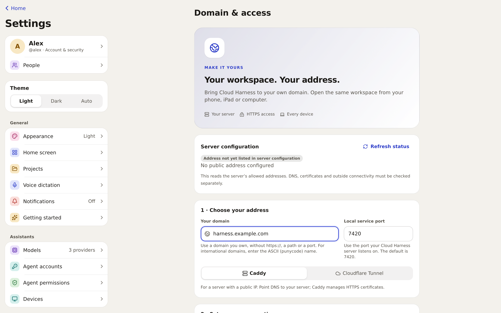
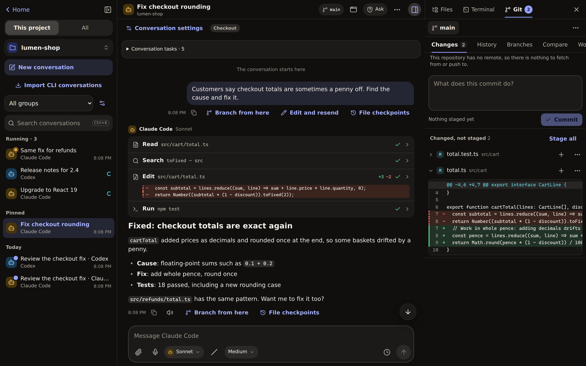

# A look around Cloud Harness

**Your coding agents, anywhere you are.**

[简体中文](showcase.zh-CN.md) · [Install Cloud Harness](../../README.md#quick-start) · [All guides](README.md)

The pictures show the real application running a fictional shop project,
`lumen-shop`. Agent replies are scripted for the demo; they are not live Claude
Code, Codex or API calls, and the device frame is a browser viewport, not a test
on a physical phone. A fresh installation has no sample accounts, credentials
or integrations. The scripts that make these pictures are in
[scripts/showcase](../../scripts/showcase/README.md).

## Approve from your phone

Each conversation has a permission mode. In **Ask**, the default, an agent stops
before it edits a file, runs a command or uses the network, and the request
shows exactly what it wants to do: the diff, the command or the address. Answer
it in the conversation from any signed-in device. **Allow and remember** saves a
rule for this conversation, the project or always. Nobody answers within 30
minutes? The request is denied and the agent carries on without it.

**Try it:** start a conversation in **Ask**, ask for a small change, and answer
the request from your phone.

[Agents and approvals](agents-and-approvals.md)

## See what changed, and why

Every file read, search, edit and command appears in the conversation as it
happens. Open a step to see its full input and output. Beside the conversation,
**Files**, **Terminal** and **Git** show the project itself: the changed files,
their diffs, and a commit box.

Runs live on the server, so a browser that disconnects reconnects to their
record; the server and the agent process still need to keep running.
**Branch from here** and **Edit and resend** try another direction in a new
conversation without rewinding your files. Text-file checkpoints have their own
preview and restore.

[Working on projects](working-on-projects.md) · [Conversations and branches](conversations.md)

## Every agent, one place

Use Claude Code and Codex through their official CLIs with the sign-ins you
already have, or add a provider using Anthropic's native Messages API or an
OpenAI-compatible API, including local model servers. The models you can choose
come from your configuration; your accounts remain your own.

**Try it:** sign in to a detected CLI, or open **Settings → Models** and add your
provider. Choose the agent and model when you start a conversation. Separate CLI
sign-ins live under **Settings → Agent accounts**.

[Model setup](providers.md)

## Two agents, one review

Choose **Ask several agents…** to give the same prompt to two to six agents.
Their answers appear together, and another agent can compare them. In a shared
folder the agents only read and plan; the owner can give each one its own Git
worktree when changes are needed. Nothing is merged automatically.

To pass work along instead, choose **Conversation actions (⋯) → Continue with
another agent…**. The new conversation gets a brief of the earlier work and your
note, and both sides keep a record of the handoff.

[Handoffs and multi-agent tasks](memory-automation-notifications.md#several-agents)

## Memory your agents share

Write a decision down once and the next conversation can find it. Memory is a
set of Markdown notes, per project and global, that people read and edit in
**Memory** and that Claude Code, Codex and tool-capable API models reach through
the same memory tools. A run sees its own project and global notes only. Agents
may read anyone's notes but change only their own, and the owner can turn agent
access off.

**Try it:** write the project's test command in a note, then ask the agent in a
new conversation to look it up before planning.

[Memory scopes, permissions and editing](memory-automation-notifications.md#shared-memory)

## Know what is running

**Running** lists the work in all your conversations: what is busy and what is
waiting for you. Open one to read its record or stop it. **Inbox** collects
approvals, problems and finished results. Reminders and scheduled runs live in
**Automations**; unattended work can never approve its own requests.

[Inbox, schedules and notifications](memory-automation-notifications.md)

## Your server, your keys

The installer puts Cloud Harness on your own Linux, macOS or WSL machine as a
service for your user. On Linux with bubblewrap installed, agents run in a sandbox. People
sign in with passwords or passkeys, and API tokens can never approve anything.

To reach it from other devices, the owner opens **Settings → Domain & access**,
enters a hostname they control and copies the generated **Caddy** or
**Cloudflare Tunnel** configuration. DNS, the proxy or tunnel and the service
restart still happen on your own infrastructure; the page does not change them.

[Install Cloud Harness](../../README.md#quick-start) · [Remote access](../deployment/remote-access.md) · [Security](../../SECURITY.md)

## And more

- **Tools and skills:** save repeated prompts as slash commands, longer
  workflows as skills, and connect MCP servers. Remote tool calls follow the
  same approvals. [Tools and skills](tools-and-skills.md)
- **Mail:** read Gmail or Outlook in a safe text view, keep encrypted drafts and
  send only after an explicit review. [Mailbox setup](mail-and-channels.md)
- **Project apps, images and voice:** reviewed static builds with sandboxed
  previews, image annotation, dictation and an isolated agent browser.
  [Project apps](project-apps.md) · [Browser, images and voice](browser-and-media.md)
- **Any screen:** a wide workspace on a computer, a focused one on a tablet and
  a touch-friendly conversation on a phone, as an installable PWA, in English
  or Simplified Chinese, light or dark. [Current status and limits](../STATUS.md)

The workspace in dark mode

