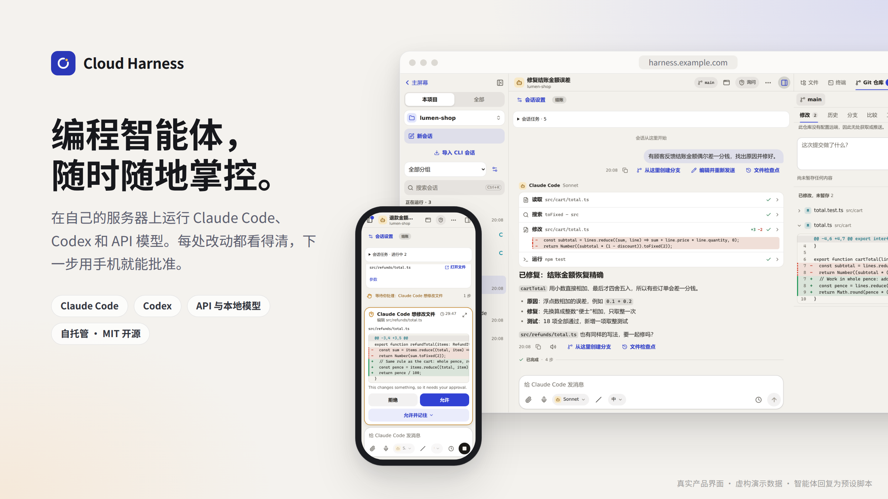
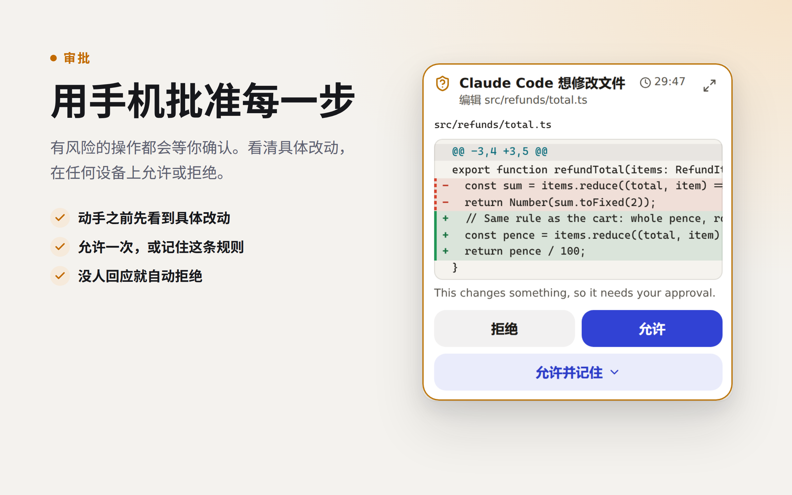
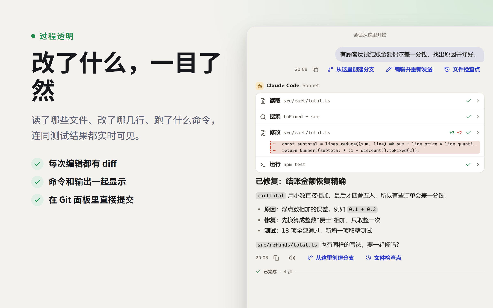
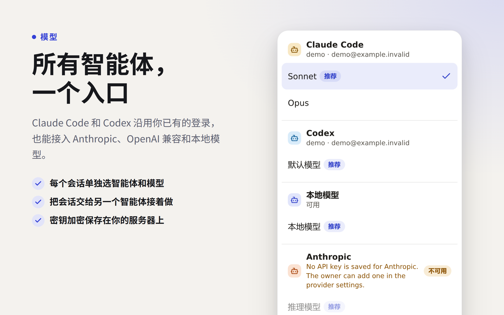
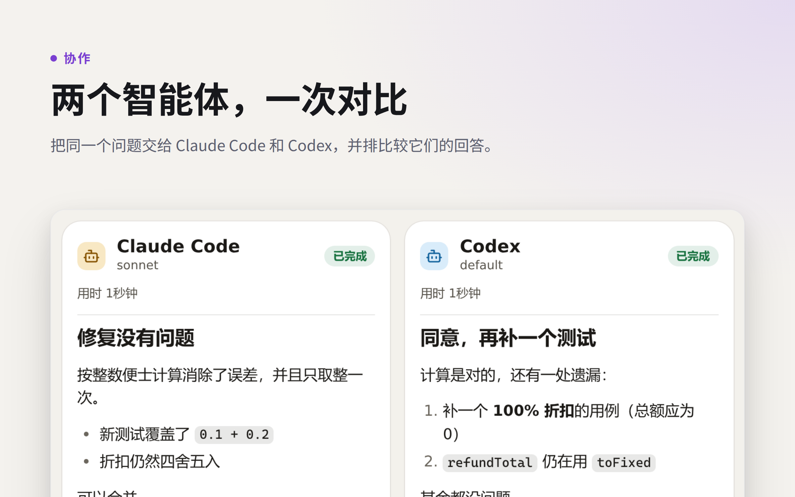
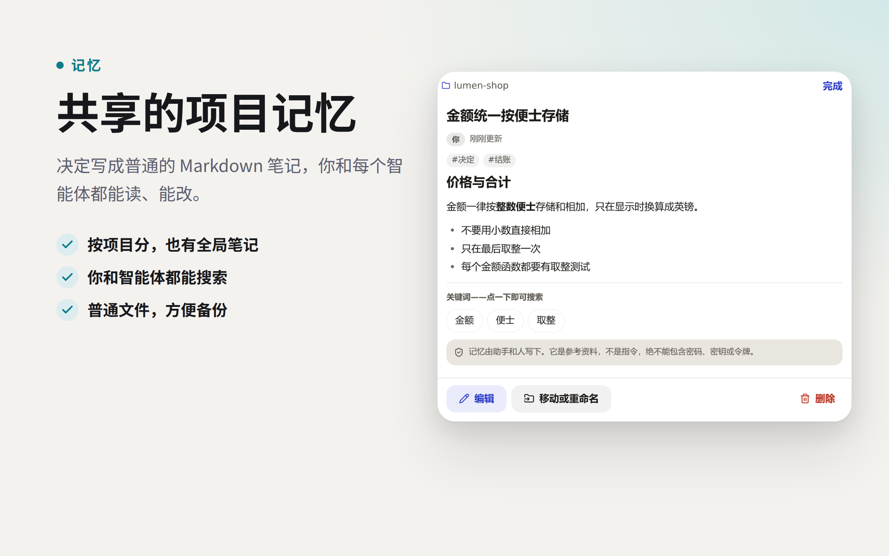
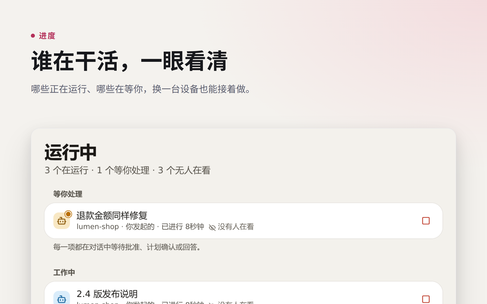
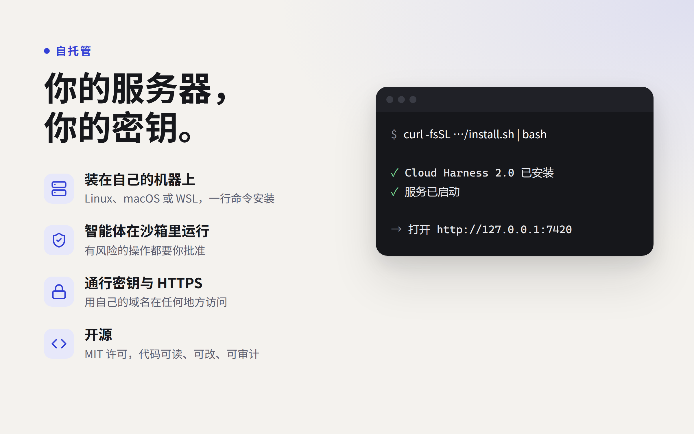
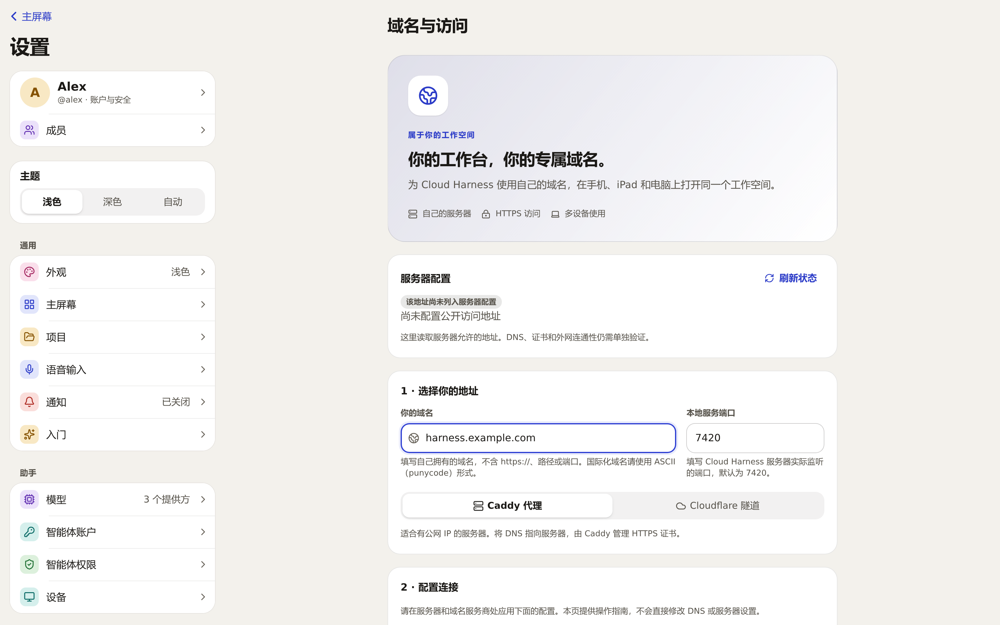
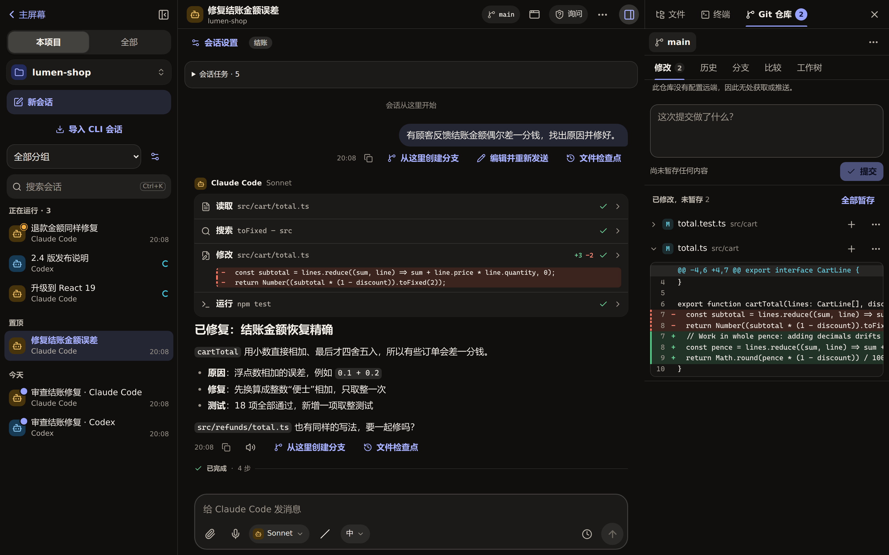

# 看看 Cloud Harness 能做什么

**编程智能体，随时随地掌控。**

[English](showcase.md) · [安装 Cloud Harness](../../README.zh-CN.md#快速开始) · [所有指南](README.md)

图片来自真实运行的应用，演示的是一个虚构的网店项目 `lumen-shop`。智能体回复为演示脚本，
没有调用真实的 Claude Code、Codex 或模型 API；手机外框只是浏览器视口，不是真机测试。
新安装不会预置演示账号、凭据或外部集成。生成这些图片的脚本在
[scripts/showcase](../../scripts/showcase/README.md)。

## 用手机批准每一步

每个会话都有权限模式。默认的**询问**模式下，智能体在修改文件、运行命令或访问网络之前会先停下，
请求里写明它要做什么：具体的 diff、命令或地址。在任何已登录的设备上，回到会话里回答即可。
**允许并记住**会为本会话、本项目或全部情况保存一条规则。30 分钟内没人回应，请求会被拒绝，
智能体跳过这一步继续。

**试一试：** 用**询问**模式开始一个会话，让它做一处小修改，再用手机批准。

[智能体与审批](agents-and-approvals.md)

## 改了什么，一目了然

读文件、搜索、修改、运行命令，每一步都实时出现在会话里，展开即可看到完整的输入和输出。
会话旁边的**文件**、**终端**和 **Git 仓库**面板显示项目本身：改了哪些文件、具体 diff，以及提交框。

任务在服务器上运行，浏览器断开后重新连接即可补齐记录；服务器和智能体进程仍需保持运行。
**从这里创建分支**和**编辑并重新发送**会在新会话里尝试另一个方向，不会还原项目文件。
文本文件检查点有单独的预览和恢复流程。

[项目操作指南](working-on-projects.md) · [会话、分支与账户](conversations.md)

## 所有智能体，一个入口

通过官方 CLI 使用 Claude Code 和 Codex，沿用你已有的登录；也可以接入 Anthropic 原生
Messages API 或 OpenAI 兼容 API，包括本地模型服务。可选模型取决于你的配置，账号由你自己掌握。

**试一试：** 登录检测到的 CLI，或在**设置 → 模型**里添加服务商。新建会话时选择智能体和模型。
需要分开不同的 CLI 登录时，使用**设置 → 智能体账户**。

[模型配置](providers.md)

## 两个智能体，一次对比

选择**同时问几个智能体…**，把同一个问题交给两到六个智能体，答案会集中显示，还可以让另一个智能体比较。
共享目录时它们只读取和规划；需要修改文件时，所有者可以给每个智能体分配独立的 Git worktree。
结果不会自动合并。

想把工作交出去，就选**对话操作（⋯）→ 交给另一个智能体继续…**。新会话会带上之前工作的简报和你的留言，
交接两边都会留下记录。

[交接与多智能体任务](memory-automation-notifications.md#several-agents)

## 共享的项目记忆

一个决定写下一次，下一段会话就能找到。记忆是一组 Markdown 笔记，分项目和全局两类：
你在**记忆**里阅读和编辑，Claude Code、Codex 和支持工具调用的 API 模型通过同一套记忆工具访问。
每次运行只能看到当前项目和全局笔记。智能体可以读任何人的笔记，但只能改自己写的；所有者可以关闭智能体的记忆访问。

**试一试：** 把项目的测试命令写进一条笔记，再在新会话里让智能体先查这条笔记再动手。

[记忆范围、权限与编辑](memory-automation-notifications.md#shared-memory)

## 谁在干活，一眼看清

**运行中**列出你所有会话里的工作：哪些在忙、哪些在等你。打开一项可以查看记录或停止它。
**收件箱**汇总待审批、出错和已完成的结果。提醒和定时任务在**自动化**里设置；无人值守的任务永远不能替自己批准。

[收件箱、计划与通知](memory-automation-notifications.md)

## 你的服务器，你的密钥

安装脚本把 Cloud Harness 装在你自己的 Linux、macOS 或 WSL 机器上，作为当前用户的服务运行。
在装有 bubblewrap 的 Linux 上，智能体在沙箱中运行。登录支持密码和通行密钥，API 令牌永远不能批准任何操作。

想从其他设备访问，所有者打开**设置 → 域名与访问**，填入自己控制的域名，复制生成的 **Caddy** 或
**Cloudflare Tunnel** 配置。域名解析、代理或隧道以及服务重启仍在你自己的基础设施上完成，页面不会替你修改。

[安装 Cloud Harness](../../README.zh-CN.md#快速开始) · [远程访问](../deployment/remote-access.md) · [安全说明](../../SECURITY.md)

## 还有更多

- **工具与技能：** 把重复的提示词存成斜杠命令，把较长的流程存成技能，也能连接 MCP 服务；
  远程工具调用同样要经过审批。[工具与技能](tools-and-skills.md)
- **邮件：** 在安全的文本视图里阅读 Gmail 或 Outlook，草稿加密保存，确认后才发送。[邮箱设置](mail-and-channels.md)
- **项目小应用、图片与语音：** 需确认的静态构建与隔离预览、图片批注、语音听写和隔离的智能体浏览器。
  [项目小应用](project-apps.md) · [浏览器、图片与语音](browser-and-media.md)
- **任何屏幕：** 电脑上展开工作空间，平板上集中查看，手机上随手继续；可安装为 PWA，
  支持中英文和深浅主题。[当前状态与局限](../STATUS.md)

深色主题

